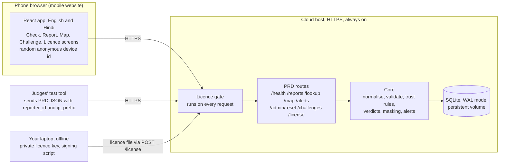
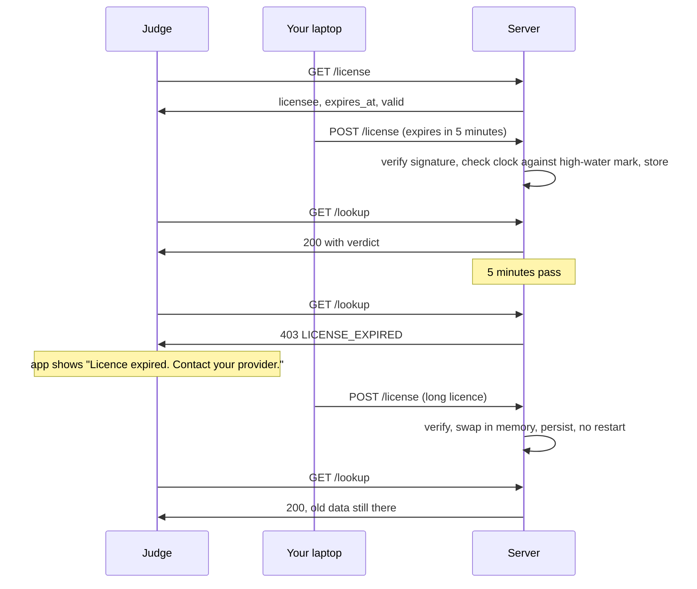

# Community Scam Map: Architecture and System Design

Oct 31, 2026 · Shubhang

A mobile website backed by a Python API on a cloud server lets anyone check a phone number, UPI ID, link or SMS sender in under half a second, report a scam in under 60 seconds without an account, and see the last 7 days of reports by area. The API follows the organisers' contract in `docs/PRD.pdf` Appendix A exactly, because the judges' test tool scores the live server against it.

## At a glance

Every request passes the licence gate first. Only `/health` and `/license` work when the licence has expired. The private key never leaves your laptop; the server holds only the public key.

## Request paths

**Report (`POST /reports`)**

1. Validate: identifier type and value, `pincode` in the area table, `occurred_at` a valid time with an offset and not in the future. Anything invalid is `400 {"error": "..."}`. Junk like `12345` or `test` lands here on purpose.
2. Normalise the identifier to its single standard form (rules below).
3. Turn `reporter_id` and `ip_prefix` into keyed HMACs. For our own web app, which sends no `ip_prefix`, the server takes the connection's /24 (IPv4) or /48 (IPv6) prefix. The raw values are never stored.
4. Rate limit: more than 3 reports from one reporter in an hour gets `429`, which the PRD allows.
5. Fingerprint the note (character shingles), keep the fingerprint, length and originality score, and discard the text.
6. Store the report, re-cluster this identifier's reports, recompute its case row (counts, verdict) and the area's day counts.
7. Reply `201 {"report_id", "case_id", "merged"}`; `merged` is true when the identifier already had a case.

**Lookup (`GET /lookup?type=&value=`)**

1. Validate and normalise the value; invalid is `400`.
2. If it is on the verified list (Appendix C), return `VERIFIED_BUSINESS` whatever the reports say.
3. Otherwise read the identifier's case row by its HMAC: one indexed read. No row is `200` with `NO_REPORTS`, never `404`.
4. Build `display_value` from the normalised query value, masked unless `distinct_reporters` is at least 3.
5. `evidence` lists `occurred_at`, `channel`, `scam_type` and `pincode` only.

**Map and alerts** read the per-area day counts, which hold trusted counts only. Windows come from `occurred_at` against the server clock.

## Licence lifecycle

- **Format:** `{"licensee", "expires_at", "signature"}`. The signature is Ed25519 over the canonical JSON of the other two fields (sorted keys, no spaces, UTF-8), base64-encoded.
- **Keys:** `scripts/license_keygen.py` and `scripts/license_sign.py` run on your laptop. The private key lives outside the repo (`~/.scam-map/license.key`); `.gitignore` blocks `*.key`. The public key is in `api/app/license/public_key.pem`.
- **Check on every request:** the parsed, already-verified licence sits in memory, so each request only compares `now` with `expires_at`. That keeps lookups fast.
- **Renewal:** `POST /license` verifies, then swaps the in-memory licence and writes it to the database, so it survives restarts.
- **Clock rollback:** the server stores the latest time it has seen. If the clock ever reads more than a minute earlier than that, the licence counts as expired until the clock recovers.
- **Expired means locked, never deleted.**

## Normalisation rules

| Type | Standard form | Examples |
| --- | --- | --- |
| `phone` (mobile or landline) | `+91` and 10 digits, first digit 2 to 9 | `+91 98765 43210`, `09876543210`, `98765-43210`, `919876543210` all become `+919876543210`; `+91 80 4100 2233` becomes `+918041002233` |
| `phone` (short helpline) | Digits as written, from an allowlist | `1930`, `1909` |
| `phone` (toll-free) | `1800` or `1860` and 4 to 7 more digits, no spaces | `1800 1600` becomes `18001600`; `1860 419 5555` becomes `18604195555` |
| `upi` | Lower case, no spaces, one `@` | `Ravi12@OKAXIS` becomes `ravi12@okaxis` |
| `url` | `https://`, host lower case without `www.`, nothing after `?` or `#`, no trailing `/` | `http://www.sbi-kyc.in/pay?utm=sms` becomes `https://sbi-kyc.in/pay` |
| `sender_id` | The 6-letter code in upper case, without the 2-letter prefix | `VM-HDFCBK`, `AD-HDFCBK` and `HDFCBK` all become `HDFCBK` |

Anything that does not fit is `400`. Every example from the PRD is a test case in `shared/vectors/normalise.json`.

## Trust rules

Goal: none of the PRD tricks can make a number `KNOWN_SCAM`, while a real campaign, where unrelated people write in their own words, still does. Every number below is a starting value in `api/app/core/trust_config.py`, tuned on the judge simulator's tuning seeds and checked on held-out seeds.

1. **One person is one person.** Reports with the same reporter HMAC count once, however many times they report. More than 3 reports from one reporter in an hour gets `429`.
2. **One connection is one person.** Reports from the same `ip_prefix` HMAC within 24 hours merge into one cluster, which stops 22 accounts on one Wi-Fi.
3. **Copy-paste is one voice.** Notes whose fingerprints are near-duplicates (shingle Jaccard similarity of 0.8 or more) merge their clusters across different people.
4. **Coordinated bursts are capped.** First-time reporters on one identifier within one hour of each other are treated as coordinated when their notes are mostly empty or near-duplicate, or when their `occurred_at` times all fall within 15 minutes. A coordinated burst adds at most 1.5 weight in total and is marked suspect. A real sudden wave, where people were called at different times and write their own words, is not capped; that case is in the simulator so the rule is checked both ways.
5. **Own words count more.** Each independent cluster weighs 1.0 with an original note of at least 15 characters, 0.6 with an empty or very short note.
6. **Verdict.** `VERIFIED_BUSINESS` if on the verified list. Otherwise `KNOWN_SCAM` if there are at least 3 independent clusters and the weighted score is at least 3.0, unless under challenge, which caps it at `SUSPICIOUS`. `SUSPICIOUS` for any accepted report below that. `NO_REPORTS` for none.
7. **Counts.** `report_count` is accepted reports; `distinct_reporters` is the number of independent clusters.
8. **Report status.** Every stored report is `counted` (first report of its cluster), `merged` (same person, connection or copied note as an earlier one) or `suspect` (part of a coordinated burst). Alerts and the map use only `counted` reports, so fakes the rules ignored never set off an alert.

What these rules cannot do: tell apart 40 friends who each write their own words, over several days, from different networks, from a real campaign. The README says so, and the simulator includes that case so we know where the line sits.

## Map and alerts

- **Areas:** the 25 Appendix B points, plus Bengaluru pincode centroids computed from the datameet 2014 file (CC BY-SA 2.5 India), flagged as our own additions. Appendix B wins where both exist.
- **`GET /map?pincode&days=7&radius_km=2`:** one cluster per area within the radius (great-circle distance from the requested area's point) that has trusted reports with `occurred_at` inside the window. Each cluster has the area's own point, the count, the top scam type and a severity of `CRIT`, `HIGH` or `MED` from fixed count bands. Month-old reports never appear.
- **`GET /alerts?pincode`:** `SPIKE` when trusted reports in the last 24 hours are at least double the daily average of the 7 days before and at least 5. `NEW_TYPE` when a scam type appears in the last 24 hours that the area has not seen in the 30 days before. Nothing else. No alerts is `{"alerts": []}`.
- **Trusted counts:** only `counted` reports go into `area_day`; `merged` and `suspect` reports never do, so ignored fakes never set off an alert.

## Data model

> `/map` and `/alerts` read counted reports directly instead of an `area_day` table (DECISIONS D58). Hosted on a laptop (D59).

SQLite in WAL mode on a persistent volume. Every identifier and reporter field is a keyed HMAC; the keys come from environment secrets set on the host.

| Table | Key columns | Notes |
| --- | --- | --- |
| `reports` | id, external `report_id`, `case_id`, identifier type, identifier HMAC, reporter HMAC, ip-prefix HMAC, channel, scam type (unknown values stored as `other`), pincode, `occurred_at` (UTC), `reported_at`, note fingerprint, note length, originality, has_screenshot, amount_lost_inr, cluster id, weight, origin | No note text, no raw identifier, no raw reporter fields |
| `cases` | case_id, identifier HMAC, type, report_count, distinct_reporters, weighted score, verdict, first_seen, last_seen, top scam type, challenged | The single row a lookup reads |
| `area_day` | pincode, day, scam type, trusted count | Feeds the map and both alert rules |
| `areas` | pincode, locality, city, lat, lng, source (`prd` or `datameet`) | Reference data, kept on reset |
| `verified` | type, normalised value, owner | Appendix C, kept on reset |
| `challenges` | challenge_id, identifier HMAC, claimant name, contact email, proof note, status, created | Cleared on reset; never returned or logged |
| `rate_counters` | reporter HMAC, hour, count | Expire after a day |
| `license_state` | current licence JSON, high-water time | Kept on reset |

## API

The PRD routes are the contract; `shared/contract/*.schema.json` encodes them and the contract tests enforce them.

| Route | Reply | Notes |
| --- | --- | --- |
| `GET /health` | `200 {"ok": true}` | Always works, even when expired |
| `POST /reports` | `201 {"report_id", "case_id", "merged"}`, `400 {"error"}`, `429` | Body exactly as PRD Appendix A section 2 |
| `GET /lookup?type&value` | `200` with `verdict`, `report_count`, `distinct_reporters`, `first_seen`, `last_seen`, `scam_type`, `display_value`, `evidence`, `challenged`; `400` for invalid values | Unreported is `200 NO_REPORTS` |
| `GET /map?pincode&days&radius_km` | `200 {"clusters": [...]}` | Defaults: 7 days, 2 km |
| `GET /alerts?pincode` | `200 {"alerts": [...]}` | `SPIKE` and `NEW_TYPE` only |
| `POST /admin/reset` | `200` | Deletes all reports, cases, counts and challenges; no login (PRD) |
| `POST /challenges` | `201 {"challenge_id", "status": "under_review"}` | Bonus |
| `GET /license` | `200` with licensee, expires_at, valid | Works when expired |
| `POST /license` | `200` with the new licence, `400` if the signature or date fails | Works when expired; no restart |
| `GET /app/areas` | `200` with the area list | UI helper, not judged |

Errors use `{"error": "..."}` as the PRD shows. Expired licence is exactly `403 {"error": "LICENSE_EXPIRED"}`.

## Web app

> Built in Streamlit instead of React (DECISIONS D54); the device id lasts one browser session (D57). The screens below are as built.

| Layer | Choice |
| --- | --- |
| App | React, Vite, TypeScript, Tailwind CSS, React Router, TanStack Query; Biome for lint and format |
| Map | Leaflet through react-leaflet, drawing Appendix B points only; a plain background when tiles cannot load |
| Languages | English and Hindi from one small dictionary module (no i18n library); every control also has an icon |
| Identity | A random device id in local storage, sent as `reporter_id`; not linked to anything |

| Screen | What it does |
| --- | --- |
| Check (home) | Paste a number, UPI ID, link, sender or a whole message; one card per identifier with the verdict, "Reported by N people near you", masked value, recent evidence, challenge and verified badges, "Call 1930" and cybercrime.gov.in |
| Report | Channel icons, time quick-picks, paste the identifier, scam type icons, area by name; one screen, no login; "I got this too" from a Check card pre-fills it |
| Map | Area points sized by count and coloured by severity; days and radius controls; alerts for the chosen area |
| Challenge | A business says "this is our real number": the PRD challenge fields |
| Licence | Shows `GET /license`; upload a licence file for the demo; the "Licence expired. Contact your provider." screen appears on any `LICENSE_EXPIRED` reply |
| How it works | Plain-language trust rules and privacy rules, linked from results |

## Privacy

| PRD rule | How we meet it | How we test it |
| --- | --- | --- |
| Keep reporters anonymous | No names, phones or accounts; `reporter_id` and `ip_prefix` stored only as keyed HMACs; area only | Database scanner finds no raw reporter field after a full simulator run |
| Hide numbers until 3 reporters | Masking in `display_value` until `distinct_reporters` reaches 3 | Contract and simulator assert masking for 0, 1, 2 and 3 reporters, all four types |
| Say "reported", not "scammer" | Fixed wording in both languages | Banned-word scan over API messages and both dictionaries |
| No scraping of personal data | Nothing calls out to any third-party service | Code scan: no outbound HTTP client in the API |
| No personal data in logs | Access logs off; our own log lines carry route, status and timing only | Log scanner reads every log line from a full simulator run and fails on any identifier, reporter field, note, email or query string |

## Deployment

| Piece | Where | Notes |
| --- | --- | --- |
| API and built web app | One container on the cloud host, HTTPS | One address for the judges and the phone |
| Database | SQLite file on the host's persistent volume | Survives deploys and restarts |
| Secrets | Host environment: HMAC keys | The licence private key is never on the host |
| Licence files | Your laptop | One that expires in 5 minutes, one long one, made just before the demo |

Before the demo: deploy, run the contract tests and the judge simulator against the HTTPS address, confirm the host has not slept, and rehearse the licence demo three times.

## Sources

- `docs/PRD.pdf`, Community Scam Map: Student Brief, 29 Oct 2026: features, privacy rules, licence, scoring, Appendix A to C.
- [datameet PincodeBoundary](https://github.com/datameet/PincodeBoundary) for extra Bengaluru centroids (CC BY-SA 2.5 India, 2014 data).
